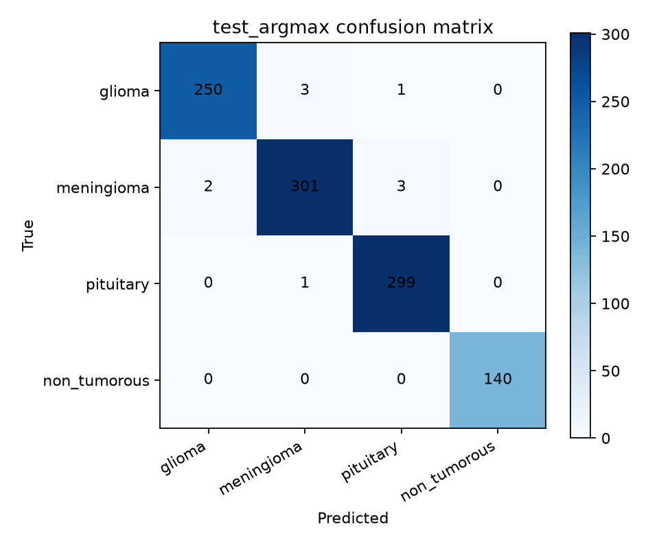
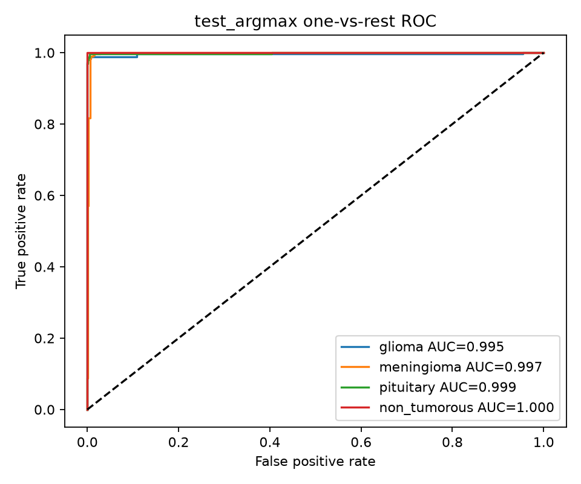
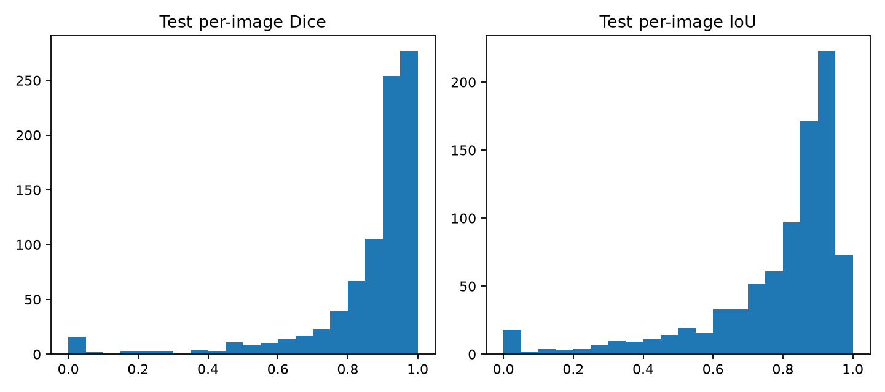

# NeuroScan — brain tumour MRI research project

> **Status: under active development.** This project is a research and learning tool, not a medical device. Its outputs are not a diagnosis and must not guide patient care.

NeuroScan works with 2D T1CE brain MRI slices from BRISC2025. The repository includes an experimental shared-encoder multi-task notebook, a Streamlit inference app, and an earlier modular classifier/segmentation pipeline. The current Streamlit app loads the multi-task checkpoint; it does not train models.

## Current multi-task run

The checked local run selected **ConvNeXt-Tiny** and produced a multi-task checkpoint and held-out test report. These figures describe that run only; they are not a promise of reproducibility on a different data split, runtime, or model checkpoint.

| Task | Test result |
| --- | ---: |
| Classification accuracy | 99.0% |
| Classification macro F1 | 0.9913 |
| Glioma recall | 98.43% |
| Segmentation mean Dice | 0.8602 |
| Segmentation mean IoU | 0.7866 |

The evaluation plots are generated from the local run:







The trained `.pth` checkpoint files are intentionally excluded from Git because they are large. Train the notebook to create a local checkpoint before running the app.

## What is included

- `train_brain_tumor_multitask.ipynb` — audit and train a shared ConvNeXt-Tiny or Swin-Tiny encoder with classification and binary segmentation heads; select thresholds using validation data and evaluate the held-out test split.
- `app.py` — upload one image, classify it, display a predicted segmentation overlay, and download the predicted mask.
- `src/` and `scripts/` — modular dataset auditing, duplicate-aware split generation, baseline classifier and U-Net/Attention U-Net training, inference and evaluation utilities.
- `pages/` — additional pages from the modular Streamlit interface. The notebook-oriented `app.py` is the documented entry point for the current multi-task model.
- `tests/` — regression and component tests.

## Requirements

- Linux or another Python 3.10+ environment
- 16 GB RAM recommended
- NVIDIA GPU with CUDA recommended for training; CPU fallback is supported but training will be much slower
- BRISC2025 dataset access through KaggleHub (or a locally supplied dataset)

Install PyTorch and torchvision for your platform using the [official PyTorch installation selector](https://pytorch.org/get-started/locally/). Then install the project dependencies:

```bash
git clone <your-repository-url>
cd <repository-directory>
python3 -m venv .venv
source .venv/bin/activate
python -m pip install --upgrade pip
python -m pip install -r requirements.txt
```

If the environment does not provide CUDA, the project uses CPU automatically. On GPU systems, install a CUDA-enabled PyTorch build before the requirements so pip can use the matching installed version.

## Dataset setup and audit

The raw dataset and generated split CSVs are excluded from Git. Download BRISC2025 with KaggleHub:

```bash
python scripts/download_dataset.py
```

Configure KaggleHub credentials using `KAGGLE_API_TOKEN` or its supported login flow. To use an existing local copy, place it under `data/raw/` or pass its directory to the audit command:

```bash
python scripts/audit_dataset.py --data-root data/raw --report-dir reports
```

Run the audit before training. It inspects the dataset layout, image integrity, image-mask pairing and dimensions, and reports findings under `reports/`. Do not commit the raw dataset; follow its source terms and access requirements.

## Train the multi-task model and run the app

Start Jupyter from the repository root:

```bash
jupyter lab train_brain_tumor_multitask.ipynb
```

Review the configuration cell, set `DATA_ROOT`, `SPLIT_DIR`, and `OUTPUT_ROOT` for your machine, and run the notebook cells in order. It checks the generated splits for duplicate leakage, compares ConvNeXt-Tiny and Swin-Tiny using validation results, calibrates tumour and mask thresholds on validation data, and evaluates the selected model on the official test data. The notebook saves checkpoints under `artifacts/checkpoints/`, metrics under `outputs/`, and figures under `artifacts/plots/`.

Once `artifacts/checkpoints/best_multitask_model.pth` exists, launch the app:

```bash
streamlit run app.py
```

Open the local URL printed by Streamlit. Upload a supported JPG or PNG MRI slice and select **Predict**. The app reports one 2D-slice prediction and generated mask; it does not perform 3D analysis or clinical localization.

## Modular training and evaluation utilities

The repository also contains a separate modular baseline workflow. It writes generated splits under `data/splits/` and checkpoints under `artifacts/checkpoints/`:

```bash
python scripts/train_classifier.py --smoke-test
python scripts/train_segmenter.py --smoke-test
```

Remove `--smoke-test` to start actual training. The segmenter accepts `--model unet` or `--model attention_unet`. Evaluate trained modular checkpoints with:

```bash
python scripts/evaluate.py --task all --split validation
python scripts/evaluate.py --task all --split test
```

Validation evaluation selects thresholds from validation records. Test evaluation uses the saved calibration when available. These scripts use the modular baseline checkpoints; they are separate from the notebook's multi-task checkpoint and the `app.py` loader.

## Verification

From the activated environment, run:

```bash
python -m compileall .
python -m pytest -q
```

The smoke-test commands above check that the modular classifier and segmenter can complete a small forward/backward pass. They do not train full models or establish clinical performance.

## Limitations

- The segmentation subset contains tumour-positive masks only; normal-slice segmentation performance is not established.
- Inputs are single 2D T1CE slices, not 3D MRI volumes.
- Available source identifiers do not establish patient-level independence.
- `non_tumorous` is a dataset label, not a clinical finding.
- This software is experimental, may contain errors, and is not intended for diagnosis or treatment decisions.

