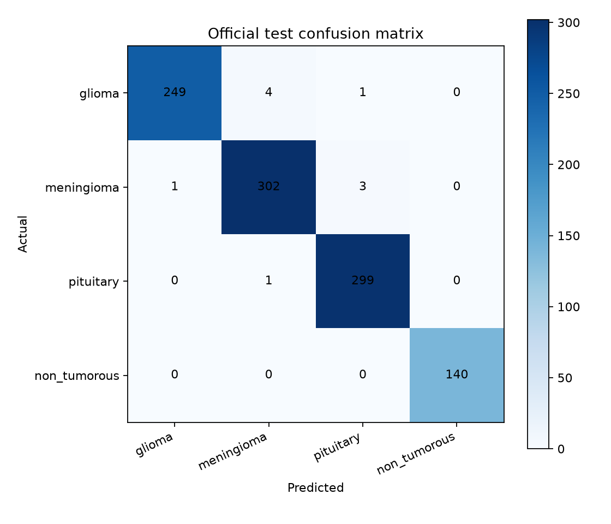
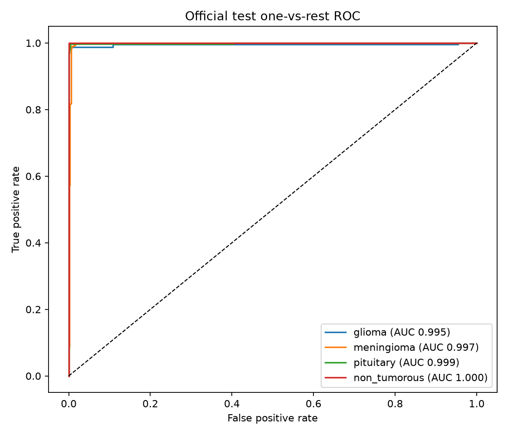
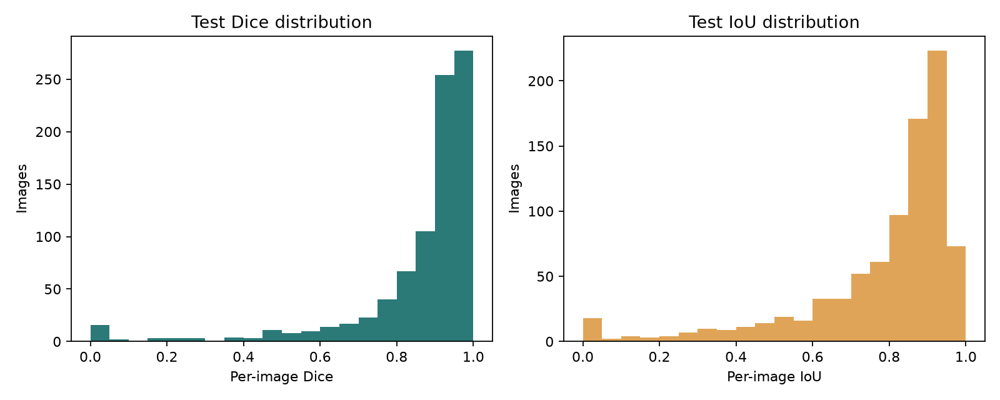
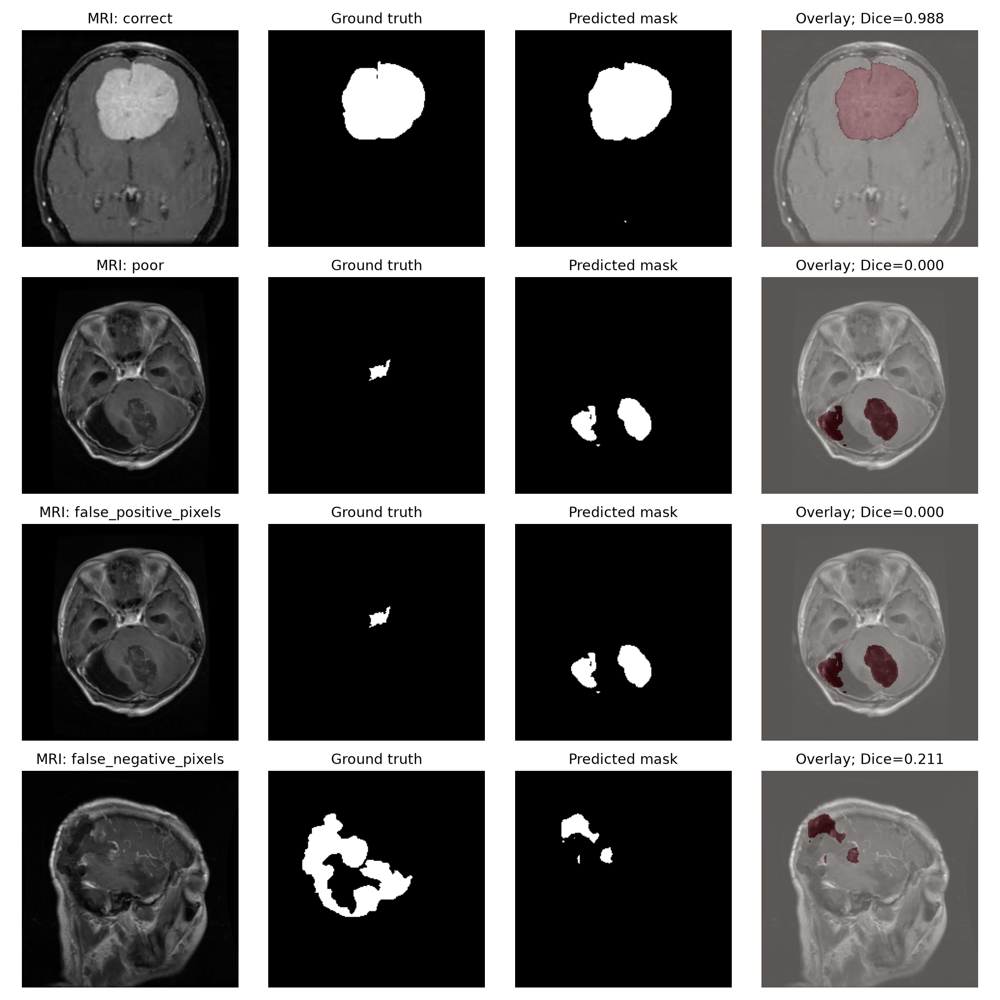

# NeuroScan — brain tumour MRI research dashboard

> **Under active development.** NeuroScan is for research and education. It is not a medical device, does not provide a diagnosis, and must not be used to make treatment decisions.

NeuroScan analyzes single 2D T1CE brain MRI slices for four-way classification (glioma, meningioma, pituitary, non-tumorous) and binary tumour-mask segmentation. The selected model is a shared ConvNeXt-Tiny encoder with separate task heads. A Swin-Tiny candidate is retained for validation comparison.

## Current saved test results

These results were generated from the official held-out BRISC2025 test partition using the local selected checkpoint. The checkpoint and raw dataset are excluded from Git; the small, path-scrubbed reports and plots are included. Thresholds were selected on validation data and frozen before this test pass.

| Measure | Result |
| --- | ---: |
| Test classification accuracy at the saved glioma rule | 99.00% |
| Test balanced accuracy at the saved glioma rule | 99.10% |
| Test macro F1 at the saved glioma rule | 0.9913 |
| Glioma recall at the saved glioma threshold (0.95) | 98.03% |
| Glioma recall with plain four-class argmax | 98.43% |
| Macro one-vs-rest ROC-AUC | 0.9978 |
| Test mean / median Dice | 0.8602 / 0.9262 |
| Test mean / median IoU | 0.7866 / 0.8625 |

Classification used 1,000 official test images. Segmentation used 860 paired annotated test images. All segmentation masks in this dataset subset are tumour-positive; normal-slice segmentation performance is not established.









## Dashboard features

- **Overview:** model and dataset facts, actual official-test results, validation-only candidate comparison, thresholds, parameter count, and recorded training duration.
- **MRI workspace:** single-image and batch JPG/JPEG/PNG inference, class probabilities, predicted binary mask, adjustable overlay opacity, inference time, and downloadable results.
- **Evaluation:** per-class precision/recall/F1, interactive confusion matrix and score distributions, ROC curves/AUC, Dice/IoU distributions, and example predictions beside reference masks.
- **Method & model:** preprocessing, split and threshold methodology, checkpoint metadata, dataset details, and research limitations.

The app starts without the dataset or a model checkpoint. Saved evaluation results can still be reviewed; image inference reports a clear missing-checkpoint status until weights are supplied.

## Requirements and installation

Use Python 3.11 or newer. For NVIDIA GPU training, install a CUDA-enabled PyTorch/torchvision pair that matches your driver using the [official PyTorch selector](https://pytorch.org/get-started/locally/) before installing the remaining project dependencies. CPU inference and training are supported, though training is slower.

```bash
git clone https://github.com/Ahmad-o-Zakariya/neuroscan-brain-mri.git
cd neuroscan-brain-mri
python3 -m venv .venv
source .venv/bin/activate
python -m pip install --upgrade pip
python -m pip install -r requirements.txt
streamlit run app.py
```

The app can also be launched from another working directory by passing the repository's absolute `app.py` path. Model and report locations are resolved relative to the repository, not the shell's current directory.

## Dataset setup and model training

The raw BRISC2025 dataset, generated split CSVs, and large model weights are not stored in Git. Download with KaggleHub after configuring Kaggle access (for example, export `KAGGLE_API_TOKEN` in your shell):

```bash
python scripts/download_dataset.py
python scripts/audit_dataset.py
```

The audit writes reports under `reports/`. For an existing dataset elsewhere, pass its root with `--data-root` or set `NEUROSCAN_DATA_ROOT` for the notebook. The notebook also accepts `NEUROSCAN_PROJECT_ROOT`, `NEUROSCAN_SPLIT_DIR`, and `NEUROSCAN_OUTPUT_ROOT` overrides.

Open the repository notebook and run cells in order:

```bash
jupyter lab train_brain_tumor_multitask.ipynb
```

It checks split integrity, trains ConvNeXt-Tiny and Swin-Tiny candidates, selects the model and both thresholds using validation data, then evaluates the selected checkpoint on the official held-out test partition. Checkpoints are written to `artifacts/checkpoints/`; run outputs go to `outputs/` and plots to `artifacts/plots/`.

To run the official test evaluation again after installing the dataset and selected checkpoint:

```bash
python scripts/evaluate_multitask.py --data-root data/raw/brisc2025
```

The script does not train, select models, or tune thresholds from test data. It writes path-scrubbed metrics, a per-class report, probabilities without image identifiers, and figures to `artifacts/reports/` and `artifacts/plots/`. Override the checkpoint with `--checkpoint` or `NEUROSCAN_CHECKPOINT`.

## Legacy modular utilities

The earlier modular baseline is preserved for CLI use. Its EfficientNet-B0 classifier and U-Net/Attention U-Net segmentation checkpoints are separate from the multi-task dashboard checkpoint:

```bash
python scripts/train_classifier.py --smoke-test
python scripts/train_segmenter.py --smoke-test --model attention_unet
python scripts/evaluate.py --task all --split validation
python scripts/evaluate.py --task all --split test
```

Remove `--smoke-test` to train. The segmenter supports `--model unet` and `--model attention_unet`. These legacy CLI programs resolve their default data, checkpoint, and report paths from the repository root.

## Verification

```bash
python -m compileall .
python -m pytest -q
```

## Development notes and limitations

- Checkpoints and source images are excluded from Git because of size and dataset terms. Download/train locally or provide a compatible checkpoint at `artifacts/checkpoints/best_multitask_model.pth` (or set `NEUROSCAN_CHECKPOINT`).
- The segmentation model was trained and evaluated only on tumour-positive annotated image-mask pairs. The app shows this limitation when reviewing non-tumorous classification outputs.
- The model resizes 2D slices to the checkpoint input size. It does not process 3D volumes or estimate physical dimensions.
- Source patient identifiers are unavailable, so patient-level independence cannot be established.
- The source label `non_tumorous` is not a clinical finding.

## License

The NeuroScan project code is licensed under the [MIT License](LICENSE). The BRISC2025 dataset is separate and remains subject to its own license, terms, and attribution requirements; the MIT License does not apply to the dataset or other third-party materials.
